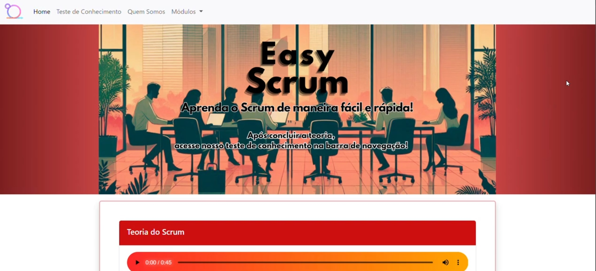
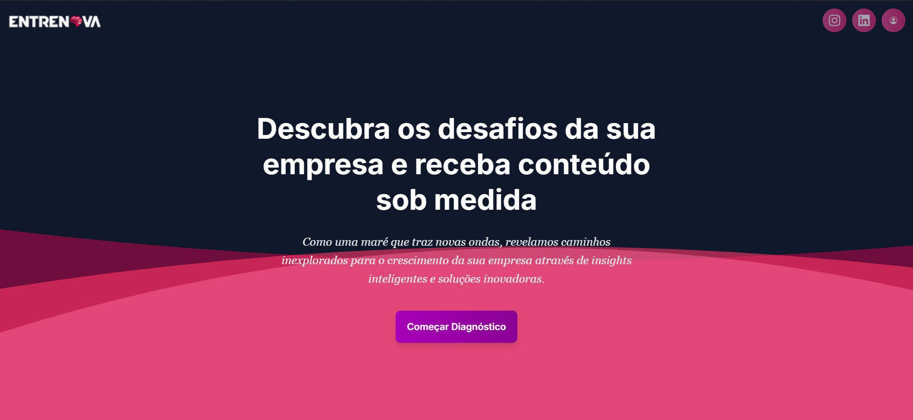
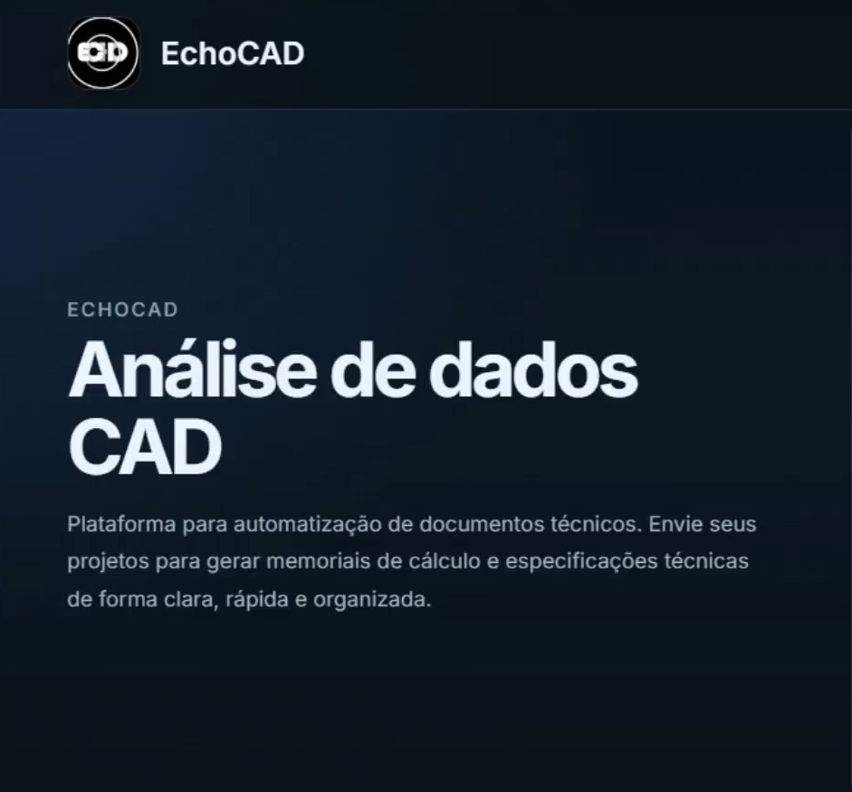

# Taylor Henrique Marinho Silva

  

## Sobre mim

Sou estudante de **Análise e Desenvolvimento de Sistemas na FATEC Prof. Jessen Vidal**, em São José dos Campos, e formado como **Técnico em Administração**. Tenho direcionado minha formação para o desenvolvimento de software, com interesse em construir soluções que unam tecnologia, organização e resolução de problemas reais.

Ao longo da graduação, participei de projetos acadêmicos em equipe, trabalhando em diferentes etapas do desenvolvimento: levantamento de requisitos, planejamento, implementação, integração com bancos de dados e documentação. Tenho interesse especial por desenvolvimento **Full Stack**, aplicações web, APIs e soluções com inteligência artificial.

Meu objetivo é continuar aprimorando minhas habilidades técnicas e colaborativas, aplicando os conhecimentos adquiridos em projetos cada vez mais completos.

## Contato

- [GitHub](https://github.com/TaylorSilva2)
- [LinkedIn](https://www.linkedin.com/in/taylor-silva-859300330/)

## Conhecimentos

- **Linguagens:** Java, Python, JavaScript, TypeScript, HTML e CSS.
- **Desenvolvimento web:** React, Next.js, FastAPI, Node.js e Express.
- **Bancos de dados e ORMs:** MySQL, PostgreSQL, Prisma e SQLAlchemy.
- **Ferramentas e infraestrutura:** Git, GitHub, Docker, AWS e Terraform.

Tenho buscado aprofundar principalmente meus conhecimentos em desenvolvimento Full Stack, arquitetura de APIs, bancos de dados, integração entre sistemas e inteligência artificial.

## Projetos acadêmicos — API

Os projetos a seguir foram desenvolvidos em equipe no programa de **Aprendizagem por Projetos Integrados (API)** da graduação. Cada seção apresenta a proposta do projeto, tecnologias e minha função registrada no repositório da equipe.

### 1º semestre — EasyScrum

[Acessar repositório](https://github.com/EquipeEcho/EasyScrum)

**Problema:** quem está começando a aprender Scrum pode ter dificuldade para entender seus papéis, eventos e artefatos e relacionar esses conceitos à prática. Conteúdos sem exemplos e formas de verificar o aprendizado também podem dificultar a aplicação da metodologia em projetos.

**Solução:** o EasyScrum é uma aplicação web educacional que organiza conteúdos explicativos, materiais de apoio e avaliações sobre Scrum em um só lugar, apoiando o estudo e a revisão dos conceitos.

**Tecnologias:** Python, Flask, HTML, CSS, Bootstrap e MySQL.

**Atuação registrada:** integrante do Scrum Team.

**Principais contribuições pessoais:**

- Implementei a expansão de conteúdos na interface para facilitar a consulta dos materiais.
- Ajustei a apresentação visual dos conteúdos expandidos, incluindo suas cores.
- Atualizei imagens utilizadas nas páginas do projeto.

### 2º semestre — BotEcho

[Acessar repositório](https://github.com/EquipeEcho/botEcho)

**Problema:** desenvolvedores precisam de apoio para analisar e compreender código e, em alguns casos, visualizar dados sem alternar entre várias ferramentas. Fazer essas tarefas manualmente pode tornar o fluxo de trabalho mais demorado.

**Solução:** o BotEcho é uma IDE com recursos de inteligência artificial para apoiar a análise e a explicação de código. Também oferece recursos para trabalhar com arquivos e gerar gráficos com Python e Matplotlib.

**Tecnologias e ferramentas:** Java, Python, Matplotlib e Ollama.

**Atuação registrada:** integrante do Scrum Team.

**Principais contribuições pessoais:**

- Contribuí para a funcionalidade de carregamento de arquivos na IDE.
- Trabalhei em prompts para explicação de código e geração de gráficos com Matplotlib.
- Implementei funções relacionadas ao fluxo de clonagem de repositórios Git e corrigi botões da interface.

### 3º semestre — EchoNova

[Acessar repositório](https://github.com/EquipeEcho/EchoNova)

**Problema:** a identificação das necessidades de treinamento das empresas parceiras dependia de entrevistas e acompanhamento manuais. Esse processo dificultava a análise das necessidades e a identificação de empresas com potencial para contratar treinamentos.

**Solução:** o EchoNova, também apresentado como **Radar Entrenova**, é uma plataforma de diagnóstico de necessidades de treinamento corporativo. A solução reúne questionários e entrevistas, gera relatórios personalizados, recomenda trilhas de aprendizagem e oferece painéis para acompanhar empresas, funcionários e resultados.

**Tecnologias:** JavaScript, TypeScript, React, Next.js, Node.js, MongoDB, Mongoose, Tailwind CSS, jsPDF e Nodemailer. O projeto também integrou ferramentas de inteligência artificial.

**Atuação registrada:** Scrum Master.

**Principais contribuições pessoais:**

- Desenvolvi funcionalidades de gerenciamento de funcionários e atualização de seus dados.
- Trabalhei nas páginas de trilhas e na ativação de trilhas para funcionários.
- Corrigi o posicionamento de elementos na página de login.
- Atuei também como Scrum Master, apoiando o planejamento e o acompanhamento do trabalho da equipe.

### 4º semestre — EchoCAD

[Acessar repositório](https://github.com/EquipeEcho/EchoCAD)

**Problema:** extrair informações de plantas CAD e preparar documentos técnicos, como memoriais de cálculo, envolve etapas manuais que podem consumir tempo e dificultar a organização dos dados.

**Solução:** o EchoCAD é uma aplicação que processa informações de plantas CAD e auxilia na geração de documentação técnica e planilhas, com recursos de inteligência artificial para apoiar a análise dos dados.

**Tecnologias:** JavaScript, TypeScript, React, Node.js, Python, Ollama e MySQL.

**Atuação registrada:** desenvolvedor.

**Principais contribuições pessoais:**

- Contribuí para a extração de informações de arquivos no formato DXF.
- Trabalhei na integração do ChromaDB com Agno para apoiar os recursos de inteligência artificial do projeto.
- Realizei ajustes na configuração da aplicação.

## Considerações finais

Os projetos de API ampliaram minha experiência com desenvolvimento de software, trabalho em equipe e aplicação de tecnologia a diferentes problemas. Pretendo continuar evoluindo como desenvolvedor Full Stack e aprofundar meus conhecimentos em arquitetura de software, APIs, bancos de dados, infraestrutura em nuvem e inteligência artificial.
